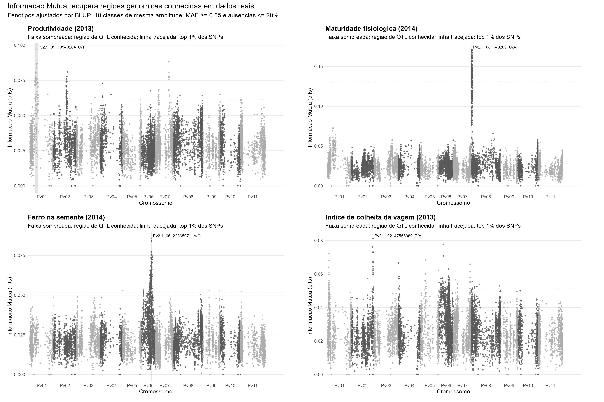
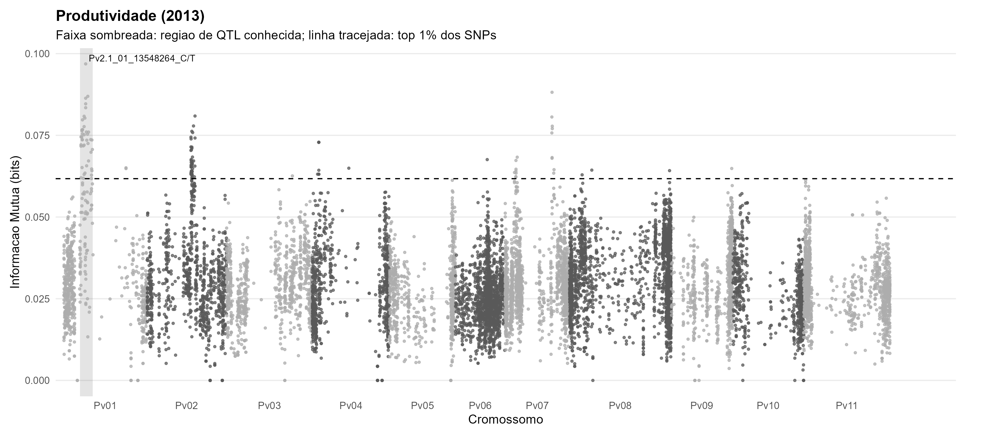
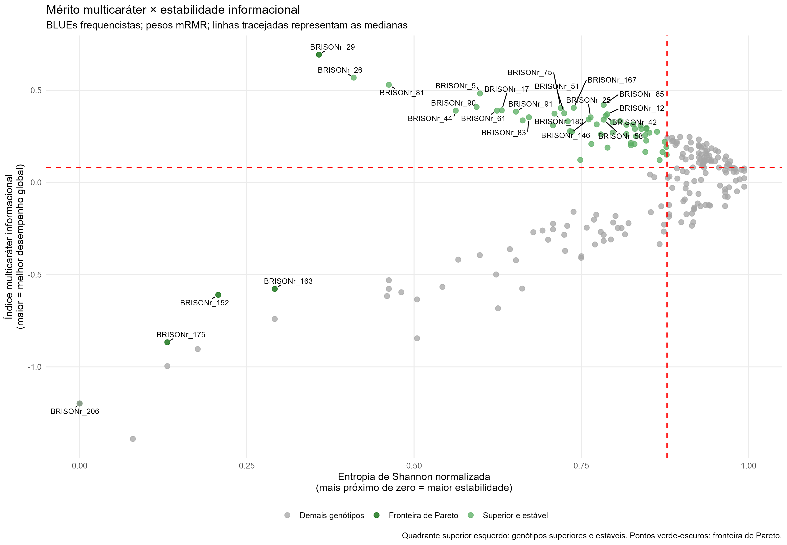

# 🌱 MIBLUP: Mutual-Information-Weighted Genomic Selection

-gold)


> 🇧🇷 Versão em português: [README.pt.md](README.pt.md)

**MIBLUP** is a genomic selection method that uses **Shannon's Information Theory** to weight SNP markers by their **mutual information (MI)** with the phenotype. Informative markers get more weight in the genomic relationship matrix, and noisy markers are shrunk towards zero. Every weight can be traced back to a genome region, so breeders can interpret the model, unlike black-box deep learning models.

🏆 **This project won 1st place (best ESALQ/USP project) in the GDM Universities Challenge.**



## How it works

1. **Discretize** the target trait (e.g. grain yield) into classes (default: 10).
2. **Compute MI** between each SNP genotype (0/1/2) and the trait classes: how much knowing the marker reduces uncertainty about the phenotype.
3. **Weight the genome:** build a weighted genomic matrix **G<sub>MI</sub>** where high-MI SNPs (candidate causal or epistatic QTLs) dominate.
4. **Predict:** solve the mixed-model equations (GBLUP framework) using G<sub>MI</sub>.

## Key results

### 1. Simulation study (`Simulacao_MI.R`)
Monte Carlo simulation with **100 independent replicates** comparing GBLUP, MIBLUP and Random Forest (an MLP is optional), including stress scenarios with strong multiplicative epistasis.
- High-MI SNPs were enriched in true causal QTLs by a mean factor of **9.1×** (up to **12.6×**) relative to chance.

### 2. Real data: MAGIC common bean population (`MAGICBeansCIAT2020/`)
Re-analysis of 444–602 lines (depending on trait/year) × ~12,200 SNPs from Diaz et al. (2020), CIAT.
- **QTL recovery:** the top-1% MI markers fall in QTL regions previously mapped by the original authors **22–39× more often than expected by chance**. This holds for yield (Chr01), physiological maturity (Chr08), seed iron (Chr06) and pod harvest index (Chr02).
- **Prediction (yield 2014, 3 × 5-fold CV):** MIBLUP r = 0.251 vs. GBLUP r = 0.245. Accuracy is the same within the confidence intervals, and MIBLUP adds marker interpretability at no accuracy cost.

| Model | Mean r | 95% CI | RMSE |
|---|---|---|---|
| GBLUP | 0.245 | 0.191 – 0.300 | 98.8 |
| MIBLUP | 0.251 | 0.195 – 0.306 | 98.7 |



### 3. Multi-environment wheat trials, Germany (`MultiEnvironmentFieldTrialsWheatBreedingGermany/`)
Uses the BRIWECS multi-environment trials (Wang et al., 2025) to compare **normalized MI (permutation bias-corrected)** with R² and Spearman correlation as measures of genotype-performance consistency across *year × location × management* conditions, for 9 agronomic traits. A second script builds an **MI-weighted multi-trait selection index** and a **Shannon-entropy stability measure**, and identifies "superior and stable" genotypes on a merit-vs-stability Pareto frontier.



## Repository structure

```text
MIBLUP/
├── Simulacao_MI.R                                   # simulation study (GBLUP vs MIBLUP vs RF)
├── MAGICBeansCIAT2020/
│   ├── Analise_MI_MAGIC_pitch.R                     # MI + QTL enrichment + CV on real bean data
│   ├── 0x. MAGIC_*.csv / *.xls                      # data from Harvard Dataverse
│   └── resultados_MI_MAGIC/                         # tables and figures
└── MultiEnvironmentFieldTrialsWheatBreedingGermany/
    ├── analise_MI_BRIWECS.R                         # MI vs R² across environments
    ├── analise_multicarater_MI_entropia_BRIWECS.R   # MI-weighted index + entropy stability
    ├── *.csv / Management_information_*.xlsx        # BRIWECS data
    └── resultados_MI_BRIWECS/                       # tables and figures
```

## How to run

```bash
git clone https://github.com/raruizc/MIBLUP.git
cd MIBLUP
Rscript Simulacao_MI.R
```

Main R packages: `rrBLUP`, `randomForest`, `dplyr`, `purrr`, `tibble`, `tidyr` (the scripts install missing packages automatically).

For the MAGIC analysis, also download `05. MAGIC_Pvulgaris_GBS.vcf.gz` from the [Harvard Dataverse](https://doi.org/10.7910/DVN/JR4X4C) (too large for this repository) into `MAGICBeansCIAT2020/`, then run `Analise_MI_MAGIC_pitch.R` from inside that folder.

> Code comments and output file names are in Portuguese.

## Data sources

1. Diaz, S., Ariza-Suarez, D., Izquierdo, P., et al. (2020). Genetic mapping for agronomic traits in a MAGIC population of common bean (*Phaseolus vulgaris* L.) under drought conditions. *BMC Genomics* 21, 799. Data: [doi:10.7910/DVN/JR4X4C](https://doi.org/10.7910/DVN/JR4X4C)
2. Wang et al. (2025). Multi-environment field trials for wheat yield, stability and breeding progress in Germany. *Scientific Data*. Data: [doi:10.6084/m9.figshare.27910269](https://doi.org/10.6084/m9.figshare.27910269)

## Author

**Ricardo Antonio Ruiz-Cardozo**: PhD candidate in Statistics and Agricultural Experimentation, ESALQ/USP.

Code released under the [MIT License](LICENSE). Datasets keep their original licenses.
